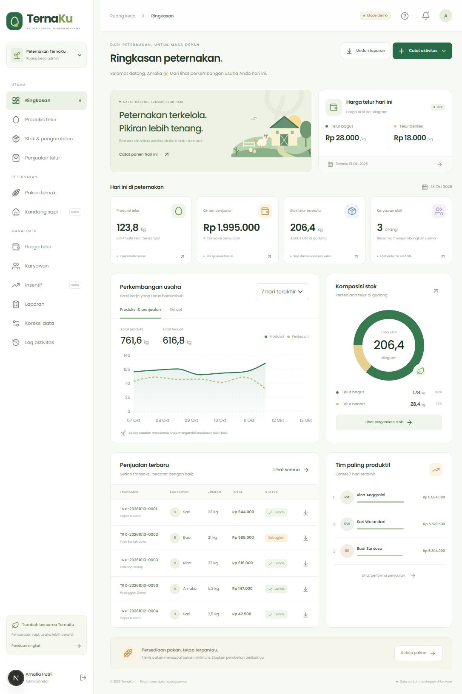

# TernaKu



Web pengelolaan telur dan pakan untuk admin serta karyawan, berbahasa Indonesia, responsif, dengan font **Poppins**. Frontend memakai **Next.js 16 App Router, React, TypeScript, Bootstrap 5**, dan Recharts. Backend terpisah memakai **CodeIgniter 3.1.13, PHP 8.2, MySQL/MariaDB InnoDB**. Frontend di-export menjadi file statis; seluruh autentikasi dan mutasi data production berjalan melalui API.

Tujuan deployment:

| Komponen   | Lokasi                                                      |
| ---------- | ----------------------------------------------------------- |
| Repository | [amaliasr/TernaKu](https://github.com/amaliasr/TernaKu)     |
| Frontend   | `https://ternaku.rstudiohub.com`                              |
| API        | `https://api.buildmanagement.id/ternaku`                    |
| Database   | MySQL pada hosting API; tidak diakses langsung oleh browser |

Source dan workflow build siap digunakan. Publikasi ke domain memerlukan akses hosting, konfigurasi domain, serta kredensial database yang sesuai; repository ini tidak menyimpan kredensial production.

## Fitur versi awal

- Dashboard produksi, omzet, stok, grafik, target, dan performa karyawan dengan filter tanggal.
- Produksi harian telur bagus/bentes: butir, kilogram aktual, jumlah krat, sumber kandang opsional, catatan, foto dan lokasi opsional. Krat dan kilogram diisi terpisah; estimasi 10 kg/krat hanya membantu input.
- Pengambilan telur per karyawan, sisa telur yang dibawa, pengembalian, dan riwayat pergerakan stok bertanggal. Validasi mencegah saldo butir/kilogram negatif dan sisa yang hanya mempunyai salah satu satuan.
- Penjualan beberapa item dalam satu transaksi, pelanggan, harga otomatis, Tunai/Transfer/QRIS/Piutang, pembayaran sebagian/pelunasan, dan nota penjualan PDF.
- Telur bentes dapat dibagikan gratis dengan nama penerima wajib diisi. Harga bentes Rp0 ditampilkan sebagai **Gratis**; jumlah telur tetap mengurangi stok, tanpa menambah omzet. Telur bagus tetap mengikuti harga jual.
- Harga bagus/bentes per kilogram, jadwal mulai berlaku, riwayat harga, notifikasi perubahan, serta snapshot harga transaksi yang tidak berubah ketika harga baru ditetapkan.
- Pembelian pakan beberapa item, nota pembelian PDF, stok/minimum pakan, dan pemakaian pakan per kandang ayam.
- Admin mengelola akun/target, menonaktifkan karyawan, mengunci catatan, meninjau koreksi, dan membaca log aktivitas. Karyawan hanya menerima transaksi miliknya sendiri; harga serta saldo peternakan dapat dilihat sesuai kebutuhan kerja.
- Tombol Daftar selalu tersedia: admin pertama dibuat dengan kode setup pemilik, sedangkan pendaftaran berikutnya menjadi karyawan yang menunggu persetujuan admin. Admin menyetujui atau menolak permohonan melalui menu Karyawan.
- Halaman karyawan khusus HP: tombol besar Panen/Jual/Gudang, stok bagus dan bentes terpisah, formulir singkat, serta rincian tambahan yang dapat dibuka bila diperlukan.
- Harga karyawan diperiksa setiap 5 detik saat aplikasi terlihat. Input tetap tersimpan di formulir selama pembaruan; harga baru pada penjualan harus ditinjau sebelum menyimpan. Status koneksi dan waktu pemeriksaan terakhir ditampilkan.
- Pemasangan ke layar utama HP sebagai aplikasi web (PWA), dengan ikon TernaKu, tampilan standalone, dan petunjuk Android/iPhone.
- Mode terang/gelap tersedia di halaman masuk, admin, dan karyawan; pilihan tersimpan pada perangkat. Foto dapat diambil langsung dari kamera atau galeri dan diperkecil otomatis sebelum dikirim.
- Notifikasi harga ke HP melalui Web Push setelah perangkat memberi izin, termasuk ketika admin menyimpan nominal harga yang sama. Penyiapan server dan cron dijelaskan dalam [panduan notifikasi HP](api/PUSH.md).
- Laporan PDF dan Excel (`.xlsx`) serta peringkat penjualan. Export dibuat di browser menggunakan jsPDF dan ExcelJS.
- **Insentif karyawan dan manajemen kandang sapi ditampilkan sebagai Coming Soon**, sesuai perubahan cakupan.

## Pasang di HP

Buka [TernaKu](https://ternaku.rstudiohub.com) lalu tekan **Pasang TernaKu di HP** pada halaman masuk atau beranda karyawan.

- **Android:** gunakan Chrome. Bila dialog pemasangan belum muncul, buka menu **⋮ → Instal aplikasi** atau **Tambahkan ke layar utama**.
- **iPhone/iPad:** buka di Safari, tekan **Bagikan → Tambahkan ke Layar Utama → Tambah**.
- Sesudah terpasang, buka ikon **TernaKu** di layar utama dan masuk dengan akun Anda.

Pemasangan tersedia melalui HTTPS dan bergantung pada dukungan browser. Aplikasi memerlukan internet untuk login, memeriksa harga, dan menyimpan catatan. Ketika aplikasi terbuka tetapi koneksi gagal, isian formulir tidak dikosongkan dan harga terakhir diberi peringatan. Menutup/memuat ulang aplikasi dapat menghilangkan isian yang belum disimpan. Service worker hanya menyimpan halaman pemberitahuan offline; data API, harga, token, dan transaksi tidak disimpan dalam cache service worker. Tidak ada antrean transaksi offline. Pemeriksaan 5 detik berhenti ketika aplikasi berada di latar belakang dan langsung dilanjutkan saat dibuka kembali.

Jika penjualan sudah dikirim tetapi hasilnya belum diketahui, aplikasi mempertahankan data percobaan pada sesi tab yang sama. Buka kembali **Jual** lalu gunakan **Coba lagi dengan data yang sama** agar permintaan memakai nomor yang sama dan tidak membuat transaksi ganda. Data ini bukan antrean otomatis; jangan menutup seluruh tab atau menghapus data browser sebelum hasil penjualan dipastikan.

Untuk pemberitahuan saat aplikasi ditutup, masuk lalu tekan **Aktifkan notifikasi** pada bagian **Notifikasi di HP** dan berikan izin browser. Gunakan **Coba notifikasi** untuk memeriksa perangkat sendiri. Pada iPhone/iPad, buka TernaKu dari ikon layar utama dengan iOS/iPadOS 16.4 atau lebih baru. Pengiriman mengikuti koneksi, izin, dan pengaturan HP; pengelola hosting perlu menyelesaikan [penyiapan Web Push](api/PUSH.md).

Manifest dan ikon berada di `public/`, registrasi service worker aktif pada build production. Uji pemasangan dengan hasil `npm run build`/`npm run preview`; pengembangan `npm run dev` tidak mendaftarkan service worker. Acuan: [panduan PWA Next.js](https://nextjs.org/docs/app/guides/progressive-web-apps) dan [pemasangan melalui browser](https://developer.mozilla.org/en-US/docs/Web/Progressive_web_apps/How_to/Trigger_install_prompt).

## Menjalankan demo lokal

Gunakan Node.js 22+ dan npm. Dari root repository:

```bash
npm ci
```

Buat `.env.local` (diabaikan Git):

```dotenv
NEXT_PUBLIC_DEMO_MODE=true
NEXT_PUBLIC_API_URL=https://api.buildmanagement.id/ternaku
```

Jalankan `npm run dev`, lalu buka `http://127.0.0.1:3000`. Mode ini diberi label **DEMO** dan hanya menyimpan data contoh di browser (localStorage).

| Peran demo   | Email              | Password   |
| ------------ | ------------------ | ---------- |
| Atasan/admin | `admin@ternaku.id` | `Demo123!` |
| Karyawan     | `sari@ternaku.id`  | `Demo123!` |

Akun tersebut hanya berlaku dalam mode demo, tidak dibuat oleh installer API. Data demo tidak otomatis dikirim ke database dan tidak menggantikan API jika koneksi production gagal. Untuk mengulang demo dari awal, hapus data situs/localStorage pada browser.

## Menjalankan dengan API dan database nyata

1. Siapkan PHP 8.2 dengan `pdo_mysql`, `mbstring`, `json`, dan `openssl`, serta MySQL 5.7+/8.0 atau MariaDB 10.4+ dengan InnoDB. Ekstensi PHP `curl` diperlukan untuk notifikasi Web Push dan suite integration test.
2. Buat database kosong `utf8mb4` dan user khusus database tersebut. Salin `api/.env.example` ke `api/.env`, lalu isi koneksi database. Untuk lokal, gunakan `APP_URL=http://127.0.0.1:8081` dan `ALLOWED_ORIGINS=http://localhost:3000,http://127.0.0.1:3000`.
3. Jalankan installer sekali menggunakan kredensial admin yang Anda tentukan melalui environment shell:

   ```bash
   ADMIN_EMAIL='admin@peternakan.example' ADMIN_PASSWORD='password-kuat-minimal-12-karakter' php api/scripts/install.php
   ```

   PowerShell:

   ```powershell
   $env:ADMIN_EMAIL = 'admin@peternakan.example'
   $env:ADMIN_PASSWORD = 'password-kuat-minimal-12-karakter'
   php api/scripts/install.php
   Remove-Item Env:ADMIN_PASSWORD
   ```

   Installer membuat schema, admin pertama, dan sumber `Kandang Ayam Utama`. Tidak ada password bawaan. Menjalankan ulang tidak mereset akun yang sudah ada.

4. Jalankan API dari root repository: `php -S 127.0.0.1:8081 -t api api/router.php`.
5. Ubah `.env.local` menjadi:

   ```dotenv
   NEXT_PUBLIC_DEMO_MODE=false
   NEXT_PUBLIC_API_URL=http://127.0.0.1:8081
   ```

6. Mulai ulang `npm run dev`, login dengan admin dari installer, tetapkan harga aktif, buat karyawan/jenis pakan, lalu mulai mencatat produksi. `GET http://127.0.0.1:8081/health` memeriksa runtime dan koneksi database.

Detail schema, payload command, CORS, installer, autentikasi, dan deployment ada di [panduan API](api/README.md).

Alternatif installer CLI: siapkan kode acak `SETUP_TOKEN` minimal 32 karakter pada `.env` API, lalu buka **Daftar** untuk membuat admin pertama dari browser. Kode hanya untuk pemilik hosting dan tidak dikirim ke frontend sebelum diketik pada form. Setelah ada akun, pendaftaran admin pertama terkunci; tombol Daftar tetap tampil untuk permohonan akun karyawan. Ikuti [langkah pendaftaran dan setup](api/PEMASANGAN.md#5-buat-admin-pertama).

## Deployment melalui GitHub

Untuk pemasangan manual melalui File Manager seperti RumahFlow, ikuti **[Petunjuk pemasangan API TernaKu](api/PEMASANGAN.md)**. Panduan mencakup lokasi folder, database MySQL, `.env`, pembuatan admin melalui terminal atau Cron Jobs sementara, dan pemeriksaan koneksi website.

Workflow [.github/workflows/ci.yml](.github/workflows/ci.yml) berjalan pada push ke `main`/`master`, pull request, atau pemicu manual. Workflow memasang dependencies, memeriksa TypeScript, menjalankan tes domain, memeriksa sintaks PHP aplikasi, menjalankan tes HTTP+MySQL termasuk persaingan stok, lalu membangun frontend **dengan DEMO=false**. Setelah berhasil tersedia dua artifact:

- `ternaku-web`: isi hasil static export `out/`, untuk document root `ternaku.rstudiohub.com`.
- `ternaku-api`: arsip `ternaku-api.tar.gz`, untuk folder `/ternaku` di document root `api.buildmanagement.id`. Arsip memakai daftar file yang diizinkan dan mencakup runtime CI3 resmi. File `.env`, database/log lokal, tes, dan unduhan sementara tidak dimasukkan.

Workflow menyiapkan paket deploy; belum ada transfer otomatis ke hosting karena akses deployment belum dikonfigurasi. Untuk deploy manual:

1. Unduh artifact dari GitHub Actions yang berhasil dan unggah isi `ternaku-web` ke document root frontend. Ini adalah file statis, tidak membutuhkan server Node.js di hosting.
2. Ekstrak `ternaku-api.tar.gz` ke folder API, termasuk `.htaccess`, `application/`, dan `system/`.
3. Buat `.env` di folder `ternaku/` pada hosting API, sejajar dengan `index.php`, dari contoh yang tersedia. Isi `APP_ENV=production`, `APP_URL=https://api.buildmanagement.id/ternaku`, `ALLOWED_ORIGINS=https://ternaku.rstudiohub.com`, dan kredensial database khusus hosting. Jalankan installer via terminal hosting atau Cron Jobs sementara sesuai petunjuk pemasangan.
4. Aktifkan HTTPS kedua domain dan pastikan Apache mengizinkan `.htaccess`/rewrite. Folder `application/logs/` harus dapat ditulis oleh PHP. Untuk Nginx, terapkan larangan akses direktori internal dan `.env` yang setara; `.htaccess` hanya berlaku di Apache.
5. Periksa `/ternaku/health`, login dari domain frontend, dan verifikasi bahwa `.env`, `schema.sql`, serta `application/` tidak dapat diunduh melalui browser.

Build lokal production juga dapat dilakukan dengan `.env.local` berisi `NEXT_PUBLIC_DEMO_MODE=false` dan URL API production, lalu `npm run build`. Hasilnya berada di `out/`; `npm run preview` menayangkannya secara lokal. Variabel `NEXT_PUBLIC_*` ditanam pada waktu build, sehingga perubahan URL atau mode memerlukan build ulang.

### Jika build hosting gagal karena SWC atau GLIBC

Jika log hosting menampilkan `GLIBC_2.29 not found` saat memuat `@next/swc-linux-x64-gnu`, binary tersebut tidak dapat dijalankan dengan GLIBC yang tersedia pada lingkungan build itu. Perintah `npm run build` memakai **Webpack** (`next build --webpack`) agar kompilasi dapat menggunakan fallback SWC WASM ketika native SWC tidak dapat dimuat. Turbopack membutuhkan native bindings, sehingga fallback WASM saja tidak cukup untuk build Turbopack.

Konfigurasi utama repository tetap **`next.config.ts`**. Nama seperti `6ad0815167323.next.config.ts` merupakan file tambahan; keberadaannya di pesan error tidak membuktikan file itu tersimpan di Git. Pola file sementara `*.next.config` dan `*.next.config.*` pada root sudah diabaikan oleh `.gitignore`. Jika file sementara masih ada di workspace build hosting, lakukan deployment dari checkout bersih branch `main`; mengubah `.gitignore` tidak menghapus file yang sudah ada di hosting.

Jika preset Next.js hosting tetap mengubah konfigurasi dan gagal mengimpor file bernama acak `*.next.config`, coba preset **Other** untuk build frontend statis, Node.js **22**, package manager **npm**, root **`./`**, build command **`npm run build`**, output directory **`out`**, tanpa entry file/server. Aplikasi tetap dibuat dengan Next.js; pilihan Other menguji apakah kegagalan berasal dari penyesuaian khusus preset Next.js oleh hosting. Pertahankan environment frontend production. Jalankan build baru dan periksa log karena keberhasilan GitHub Actions tidak menjamin konfigurasi server hosting sama.

Pilihan tanpa build di hosting: gunakan paket **ternaku-web** dari GitHub Actions yang berhasil, ekstrak dan unggah isinya ke hosting statis frontend sehingga `index.html` dan `_next/` berada langsung di document root. Hosting cukup melayani hasil build; tidak perlu membangun ulang atau menjalankan `npm start`. Jika native SWC tetap dibutuhkan untuk fitur tambahan di kemudian hari, penyedia hosting perlu menyediakan lingkungan Linux yang kompatibel.

Rujukan: [kegagalan memuat SWC](https://nextjs.org/docs/messages/failed-loading-swc), [static export Next.js](https://nextjs.org/docs/app/guides/static-exports), dan [konfigurasi deployment Hostinger](https://www.hostinger.com/support/how-to-deploy-a-nodejs-website-in-hostinger/).

## Aturan penting dan batas versi awal

Harga transaksi ditetapkan dari waktu server saat disimpan, walaupun tanggal laporan dimundurkan. Semua total/bayar/sisa tagihan dihitung server. Bila harga yang tampil di form berubah sebelum disimpan, frontend mengambil harga terbaru dan pengguna menyimpan kembali. Snapshot harga, sumber/kategori item, dan pemilik penjualan tidak dapat diganti melalui koreksi.

Koreksi wajib menyertakan alasan. Karyawan bisa langsung mengoreksi produksi sendiri yang belum dikunci; selain itu mengajukan persetujuan admin. Koreksi jumlah/berat produksi dan pengambilan menyesuaikan saldo fisik serta ledger, dengan mempertimbangkan penjualan/pengembalian yang sudah tercatat. Admin dapat mengoreksi kuantitas seluruh item penjualan yang sudah ada; total dihitung ulang memakai snapshot harga lama, tanpa melebihi telur yang dibawa. Nilai baru tidak boleh lebih kecil dari pembayaran yang sudah diterima karena refund/pembatalan/reversal belum tersedia. Pembayaran piutang penjualan dicatat sebagai tindakan terpisah yang diaudit.

Berat memakai maksimal 3 desimal, rupiah dibulatkan per item, dan zona waktu bisnis Asia/Jakarta. Penguncian database mencegah dua permintaan mengambil saldo yang sama. Permintaan tulis memakai ID idempotensi untuk mencegah duplikasi saat respons hilang. Backend memeriksa token aktif, role, kepemilikan, kategori, harga, dan saldo; pembatasan UI bukan satu-satunya pengaman.

Notifikasi harga dalam aplikasi mengikuti penyegaran data; Web Push dapat dikirim saat aplikasi ditutup setelah server dan perangkat disiapkan. Tidak ada integrasi WhatsApp/SMS. Foto kamera/galeri diperkecil menjadi JPEG maksimal 1 MB, lalu disimpan sebagai data gambar; belum memakai penyimpanan objek terpisah. Bootstrap memuat riwayat pengguna sekaligus; untuk volume transaksi besar perlu pagination, agregasi laporan di server, dan penyesuaian penguncian dari mutex global ke kunci per entitas. Backup database perlu disiapkan di hosting.

## Pemeriksaan lokal

```bash
npm run typecheck
npm test
npm run build
```

Tes API menjalankan transaksi nyata dan dua proses PHP paralel. Gunakan database kosong **khusus tes** yang namanya berakhiran `_test`, atur server API ke database itu, kemudian jalankan:

```bash
ALLOW_TEST_RESET=1 php api/tests/integration.php
```

PowerShell: `$env:ALLOW_TEST_RESET='1'; php api/tests/integration.php`. Tes menghapus dan membuat ulang tabel pada database tersebut. Jangan menjalankannya terhadap data bisnis. `TEST_API_URL` dapat mengganti alamat HTTP default `http://127.0.0.1:8081`. Pengujian lokal pengembangan telah dijalankan terhadap PHP 8.2 dan MariaDB terisolasi, termasuk perhitungan, snapshot harga, stok bersamaan, hak akses, koreksi, idempotensi, dan ledger pengembalian.

## Struktur repository

```text
src/app/          Next.js app dan gaya global
src/components/   Dashboard, navigasi, modul operasional, dan form
src/lib/          Tipe, aturan domain, state/API client, demo, dan export
tests/            Unit test domain frontend
api/              CodeIgniter 3, schema MySQL, installer, dan integration test
.github/workflows/ci.yml   Validasi serta paket deployment
```

Keputusan antarmodul didokumentasikan dalam [CONTRACT.md](CONTRACT.md). Lisensi runtime CI3 tercantum di [api/CI-LICENSE.txt](api/CI-LICENSE.txt).
